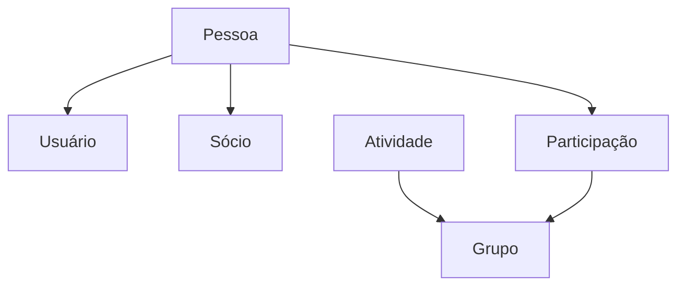

# Arquitetura do Sistema CEAL/LUZ

## Visão Geral

O Sistema CEAL/LUZ será estruturado em torno de um conceito central: **Pessoa**.

Uma pessoa pode ter diferentes vínculos com o centro, dependendo do contexto. Ela pode ser atendida, trabalhadora, sócia, usuária do sistema ou mais de uma dessas coisas ao mesmo tempo.

## Núcleo do Domínio

```text
Pessoa
  ↓
Participação
  ↓
Grupo
  ↓
Atividade
```

## Pessoa

Representa qualquer ser humano cadastrado no sistema.

Uma pessoa pode ser:

- IDE
- trabalhadora
- sócia
- usuária do sistema
- participante de grupos
- mais de uma dessas opções ao mesmo tempo

## Usuário

Representa uma pessoa que possui acesso ao sistema por login e senha.

Usuário não é a mesma coisa que sócio, IDE ou trabalhador.

Uma pessoa pode existir no sistema sem ter login.

Exemplos:

- uma pessoa atendida pode não ter acesso ao sistema;
- um sócio pode ter acesso para consultar mensalidades;
- um administrador pode ter acesso para gerenciar cadastros;
- futuramente, um IDE pode ter acesso para se inscrever em grupos ou reservar livros.

## Permissões do Sistema

As permissões do sistema devem ser independentes das funções da pessoa dentro do centro.

Exemplos de perfis de acesso:

- SUPER_ADMIN
- ADMIN
- SECRETARIA
- TESOURARIA
- COORDENADOR
- USUARIO

Exemplo conceitual:

| Perfil      | Módulo   | Inserir | Alterar | Excluir | Visualizar | Pesquisar |
| ----------- | -------- | ------: | ------: | ------: | ---------: | --------: |
| SUPER_ADMIN | Usuários |     Sim |     Sim |     Sim |        Sim |       Sim |
| ADMIN       | Usuários |     Sim |     Sim |     Sim |        Sim |       Sim |
| USUARIO     | Usuários |     Não |     Não |     Não |        Não |       Não |
| SUPER_ADMIN | Pessoas  |     Sim |     Sim |     Sim |        Sim |       Sim |
| ADMIN       | Pessoas  |     Sim |     Sim |     Sim |        Sim |       Sim |
| USUARIO     | Pessoas  |     Não |     Não |     Não |        Sim |       Sim |

## Sócio

Sócio não deve ser tratado apenas como uma permissão do sistema.

Sócio é uma condição administrativa de uma pessoa junto ao centro.

Um sócio pode ter informações próprias, como:

- matrícula;
- data de ingresso;
- situação;
- mensalidades;
- histórico financeiro.

Dentro de um grupo, a pessoa não atua simplesmente como "sócio", mas sim com uma função específica, como dirigente, facilitador, operador ou trabalhador.

## IDE

IDE é a pessoa que participa de uma atividade como atendida ou em desenvolvimento espiritual.

Uma pessoa pode ser IDE em um grupo e, ao mesmo tempo, trabalhadora em outro.

Exemplo:

- Aless é IDE em PSE-SEGUNDA-19h30;
- Aless é IDE em SAUDE-QUARTA-21h;
- Aless é operador em AUTOCON-SABADO-9h30.

## Atividade

Atividade representa um tipo de trabalho, estudo ou atendimento realizado pelo centro.

Exemplos:

- PSE
- Saúde
- Autoconhecimento
- Reiki
- Atendimento Fraterno
- Yoga
- Biblioteca
- Grupo de Estudos

## Grupo

Grupo representa uma ocorrência organizada de uma atividade, normalmente com dia e horário definidos.

Exemplos:

- PSE-SEGUNDA-19h30
- PSE-QUARTA-19h30
- PSE-QUINTA-14h
- SAUDE-QUARTA-21h
- AUTOCON-SABADO-9h30
- PET-SEGUNDA-ONLINE
- PLANETA-TERCA-21h15

Uma atividade pode ter vários grupos.

Exemplo:

```text
Atividade: PSE

Grupos:
- PSE-SEGUNDA-19h30
- PSE-QUARTA-19h30
- PSE-QUINTA-14h
```

## Participação

Participação representa o vínculo de uma pessoa com um grupo.

É na participação que o sistema identifica como aquela pessoa está atuando naquele contexto.

Exemplos de tipo de participação:

- IDE
- Trabalhador

Exemplos de função:

- Atendido
- Dirigente
- Facilitador
- Operador de TI
- Palestrante
- Trabalhador
- Coordenador

## Exemplo Completo

Pessoa: Aless

Usuário:

- possui login no sistema.

Participações:

1. Grupo: PSE-SEGUNDA-19h30
   - Tipo: IDE
   - Função: Atendido

2. Grupo: SAUDE-QUARTA-21h
   - Tipo: IDE
   - Função: Atendido

3. Grupo: AUTOCON-SABADO-9h30
   - Tipo: Trabalhador
   - Função: Operador de TI

## Modelo Conceitual Inicial



## Entidades Iniciais

- Pessoa
- Usuário
- Sócio
- Atividade
- Grupo
- Participação

## Módulos Futuros

- autenticação e login;
- cadastro de pessoas;
- gestão de usuários;
- gestão de sócios;
- mensalidades;
- cadastro de atividades;
- cadastro de grupos;
- inscrição de IDEs;
- trabalhadores por grupo;
- controle de presença;
- biblioteca;
- relatórios;
- integração com WhatsApp.
